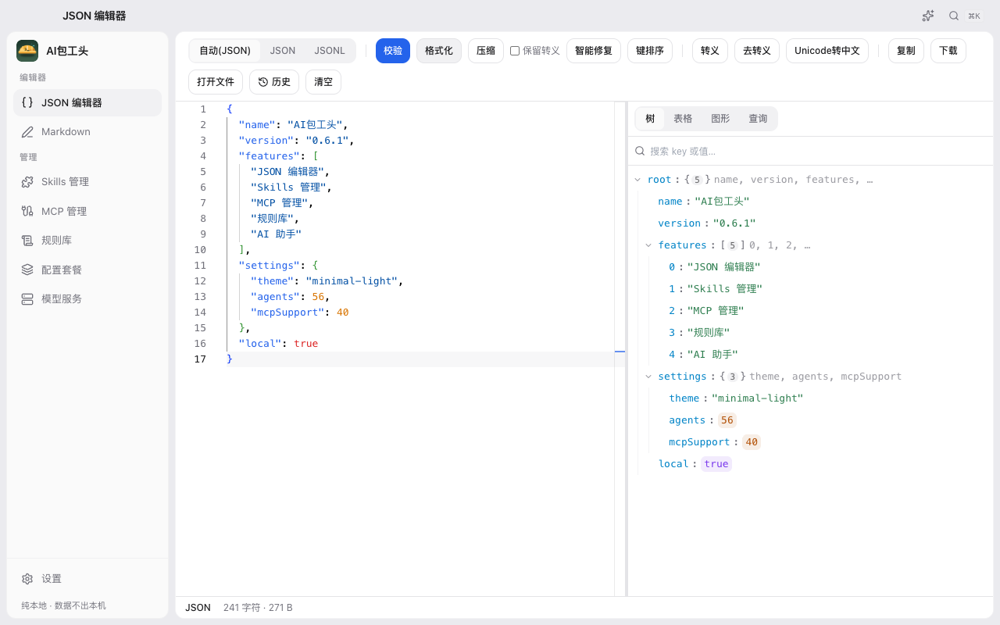
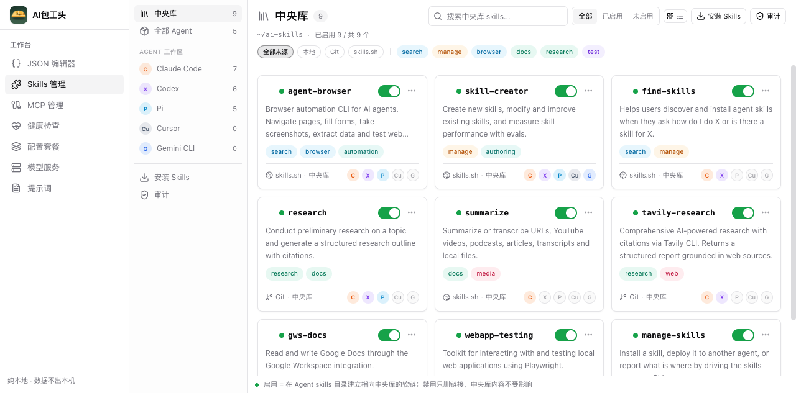
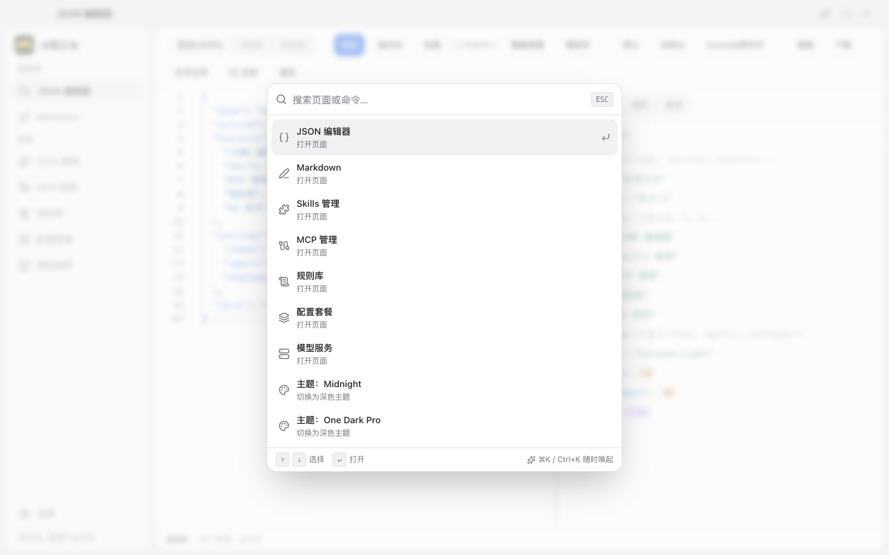
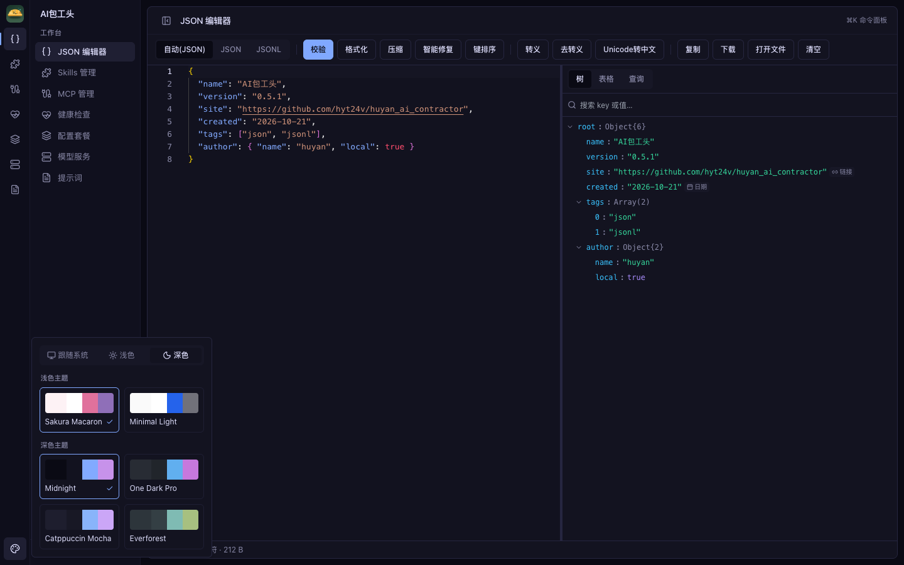
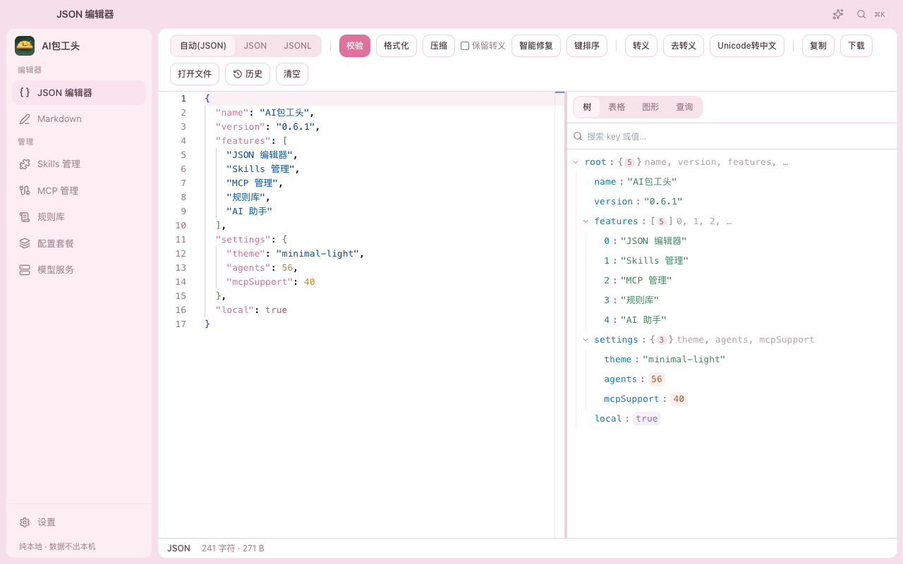

# AI包工头

<p align="center">
  
</p>

<p align="center">
  本地 AI Agent 工具箱：JSON 编辑器、Skills 管理、MCP 管理、规则库、配置套餐、模型服务、AI 助手。<br />
  纯本地运行，数据不出本机；支持网页版和 macOS 桌面 App（Tauri）。
</p>

<p align="center">
  <a href="https://github.com/hyt24v/huyan_ai_contractor/releases/latest"></a>
  
  
  
  
</p>

## 截图

### JSON / JSONL 编辑器



### Skills 管理（Skills Manager 风格）



### ⌘K 命令面板



### 主题系统



内置 6 套主题：暗色 Midnight / One Dark Pro / Catppuccin Mocha / Everforest，浅色 Sakura Macaron / Minimal Light。
支持「跟随系统 / 固定浅色 / 固定深色」三种模式，悬停实时预览，编辑器配色同步切换。

### 浅色主题（Sakura Macaron）



## 功能

- **JSON 编辑器**（对标 json.cn）：校验、格式化、压缩、转义/去转义、Unicode 转中文、复制、下载、打开本地文件/拖拽载入；右侧树形视图（缩进参考线、长文本自动换行、类型色徽章、搜索高亮）与**节点图视图**（参考 JSON Crack：分层卡片、缩放/平移/适配）；错误行列定位跳转；「保留转义」对齐 json.cn 语义——勾选时 `\n` `\uXXXX` 按字面原样保留（非 ASCII 不会被强制转义），不勾选时才解释转义
- **JSONL 编辑器**：逐行校验（错误行红标 + 状态栏统计）、格式化/压缩（空行可选保留）、代码/表格双视图（表格取字段并集，非法行单独列出）、行级操作（跳转/删除/复制/下个错误）；多行美化的 JSON 对象连写也能自动识别为 JSONL 记录
- **Skills 管理**（Skills Manager 风格）：
  - `~/ai-skills` 中央库，分组浏览（按标签/来源）、置顶收藏、聚焦视图、高密度列表、大库分批渲染
  - 按 Agent 的 Global Workspace；Add Skill 从中央库多选批量分发
  - GitHub URL 安装支持**合集仓库**（如 obra/superpowers，自动弹出子 skill 选择器）
  - 详情抽屉：左侧可折叠目录树 + Monaco 自适应语法预览（按扩展名/shebang/内容嗅探语言）
  - 本地 skill 收编、审计、市场搜索、git 更新
- **MCP 管理**：中央清单 `~/.ai-baogongtou/mcp-central.json`，勾选分发到各 Agent（支持 40 个 agent 的配置文件，含 TOML / 嵌套键 / 双文件合并等变体）；分发前 Diff 预览、自动快照、历史回滚、漂移检测；表头筛选/排序
- **规则库**：`AGENTS.md` / `CLAUDE.md` 等规则文件中心库（`~/.ai-baogongtou/rules/`），勾选 agent 后软链分发、改动一键同步；自动版本快照（上限 50）+ 历史预览 + 回滚 + 各 agent 版本标识；支持从现有项目目录扫描导入；原「提示词」页已并入（可一键导入现有提示词文件）
- **配置套餐**：把 Skills + MCP + 提示词 + 模型服务打包成套餐，一键应用（只作用于设置中开启的 agent）
- **模型服务**：7 家主流供应商预设模板一键填端点；端点测速（延迟/鉴权失败原因）；`/v1/models` 自动拉取模型列表；一个服务挂多个模型；按模型自定义参数（temperature / topP / maxTokens，留空用服务商默认）
- **AI 助手**：顶栏 ✨ 呼出右侧对话面板（可拖宽/最大化），**流式输出 + 思考过程折叠展示**（SSE 走 Rust 转发，带停滞看门狗），对话中随时切换模型；建议问题快捷发起、会话按页面隔离；复用「模型服务」的 Provider（OpenAI Responses / Chat Completions / Anthropic Messages 三协议自适应）；API key 只在 Rust 侧拼请求头，不出本机不进日志
- **界面**：岛式三面板布局 + VS Code 式全宽标题栏（兼窗口拖拽区，红绿灯悬浮避让）；单一可折叠侧栏（双击导航项展开/收起，⌘B 快捷键）；导航项可在设置中自定义排序与显隐；macOS 菜单栏托盘（安全帽图标 + 快速打开各工具）；6 套主题 + 跟随系统自动明暗
- **安全**：所有配置写入前自动备份；MCP 每 6 小时自动快照（应用打开期间）；真实文件内容不同时拒绝覆盖（软链可直接管理）

## 版本策略

在正式版之前，版本号一直保持 `0.x`：

- 允许 `0.5` → `0.6` → `0.11` → `0.16` 这样继续迭代
- **不会自动升到 `1.0`**
- 只有明确说“可以发正式版本”时，才允许使用 `1.0` 及以上版本号

## 分支与发布规则

GitHub Release 绑定的是 **tag**（commit）而不是分支，靠「tag 命名 + Pre-release 标记」区分两条发布线：

| | test 分支 | main 分支 |
|---|---|---|
| 用途 | 新功能开发、验证 | 稳定版本 |
| tag 格式 | `vX.Y.Z-beta.N`（如 `v0.6.1-beta.5`） | `vX.Y.Z`（如 `v0.6.1`） |
| Releases 页标记 | 🟠 Pre-release | 🟢 Latest |
| 是否占用首页 Latest | ❌ 否 | ✅ 是 |

发布流程：

1. 在对应分支上把版本号写入 `package.json`、`package-lock.json`（2 处）、`src-tauri/tauri.conf.json`、`src-tauri/Cargo.toml`、`src-tauri/Cargo.lock`（仅 `name = "app"` 条目）
2. commit 后 push 分支
3. 打 tag 并 push：`git tag v0.6.1-beta.5 && git push origin v0.6.1-beta.5`
4. `.github/workflows/release.yml` 被 tag 触发，自动构建 macOS Universal dmg 并创建 Release；tag 带 `-` 后缀（如 `-beta.1`）时 workflow 自动标记为 Pre-release，无需手工勾选

test 分支验证稳定后：合回 main → **更新 README 功能列表** → 在 main 上发 `vX.Y.Z` 正式版 tag。

## 下载安装

前往 [Releases](https://github.com/hyt24v/huyan_ai_contractor/releases/latest) 下载 macOS Universal 安装包：

- `AI-Baogongtou_x.y.z_darwin_universal.dmg`
- 同时支持 Apple Silicon（arm64）和 Intel（x86_64）

下载 `.dmg` 后打开，把「AI包工头」拖入「应用程序」。

首次打开如提示未验证开发者：

- macOS 15+：到「系统设置 → 隐私与安全性 → 仍要打开」
- 或执行：`xattr -cr "/Applications/AI包工头.app"` 后重新打开

## 开发

```bash
npm install
npm run dev        # 本地开发（http://localhost:1420）
npm test           # Vitest 单测
npm run build      # 产出 dist/ 纯静态文件
npm run preview    # 预览构建产物
```

桌面 App：

```bash
npm run tauri:dev    # 开发模式（热更新）
npm run tauri:build  # 打包 AI包工头.app + .dmg
```

## 技术栈

- Vite + React 18 + TypeScript
- Tailwind CSS（shadcn/ui 设计 token）
- Monaco Editor（本地打包，不走 CDN）
- HashRouter
- Tauri 2（桌面壳，含 dialog / updater / opener / process 插件）
- Rust 自定义命令：软链、目录复制、git 更新、路径检查、通用 HTTP 代理（GET/POST、自定义头、可调超时）、SSE 流式转发（AI 对话）

## 目录结构

```text
src/
  components/        通用组件 + skills/ 卡片、详情抽屉、Agent 徽章 + AiDock 对话面板
  lib/               纯逻辑（JSON/JSONL、MCP、Skills、套餐、Provider、规则库）
  pages/             JSON、Markdown、Skills、MCP、规则库、配置套餐、模型服务
  services/          与 Tauri / 文件系统交互的粘合层（含 ai/ 流式对话客户端与会话）
src-tauri/
  capabilities/      Tauri FS 权限
  icons/             全平台 App 图标（含托盘模板图标）
  src/lib.rs         Rust 自定义命令
scripts/
  build-icon.py      从一处绘图生成全平台图标
docs/images/         README 截图
```

## 新增一个工具

1. 在 `src/pages/` 新建页面组件
2. 在 `src/App.tsx` 注册路由
3. 在 `src/lib/tools.ts` 的 `TOOLS` 数组加菜单项
4. 需要文件系统能力时，通过 `src/lib/fsPort.ts` / `src/services/` 访问

## 开发原则

- 纯本地优先，不引入云端依赖
- 所有覆盖配置文件的写操作必须先备份
- 先补纯逻辑单测，再接 Tauri 文件系统
- 保持 `0.x` 版本号，直到明确进入正式版
